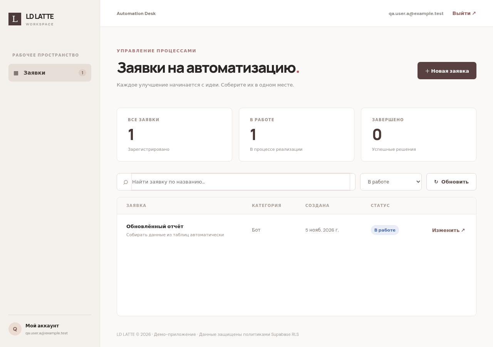
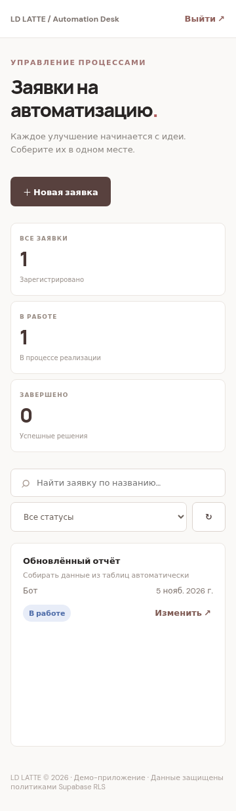
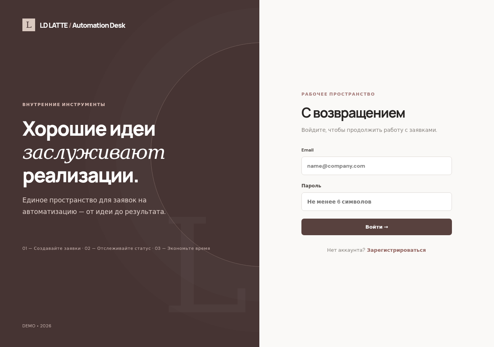

# LD LATTE — Automation Test Submission

## Действующая публичная демонстрация (5 ноября 2026)

- **[Веб-приложение — открыть](https://igornadein.github.io/ld-latte-automation-test/)** — реальный Supabase Auth и PostgreSQL, не mock.
- **[Telegram-бот — открыть](https://t.me/nadein_crm_bot)** — команда /start, меню услуг из облачной базы (сохранено прежнее имя Nadein CRM).
- **[Интеграционный отчёт Instagram — PDF](docs/LD_LATTE_Instagram_Integration_Plan.pdf)** — схема, OAuth, метрики, диагностика.
- **[Технический паспорт живого развёртывания](docs/LIVE_DEPLOYMENT.md)** — архитектура, безопасность, результаты проверок, ограничения.

**Важно:** постоянно доступный Telegram webhook сейчас реализован Supabase Edge Function, а экспортируемый n8n workflow — отдельная реализация задачи 1. n8n 2.46.6 успешно импортировал его в CI. Это не скрывается и подробно объяснено в техническом паспорте.

Тестовое задание на позицию «Технический специалист по автоматизации бизнес-процессов» (5 ноября 2026). Все данные — демонстрационные.

## Состав решения

| Задание | Реализация | Основные файлы |
|---|---|---|
| 1 — Telegram / n8n | Импортируемый n8n workflow: /start, динамические inline-кнопки, callback по ID, нулевой набор услуг | `n8n/dynamic-services.workflow.json`, `supabase/schema.sql`, `supabase/demo-services.sql` |
| 2 — Instagram | Схема архитектуры, роли и OAuth, таблица метрик и ограничений, проверки, вопросы | `docs/INSTAGRAM_INTEGRATION_PLAN.md` |
| 3 — Supabase web app | React/Vite/TypeScript, Supabase Auth + PostgreSQL, RLS, список/поиск/фильтр/редактирование, адаптивный дизайн | `app/`, `supabase/schema.sql` |

> Доступы LD LATTE и реальные данные сотрудников не используются.

## Быстрый запуск Supabase + веб-приложения

1. Создайте Supabase project (Free подходит) с включённым Auth → Providers → Email.
2. В SQL Editor выполните `supabase/schema.sql`. В нём таблицы `automation_requests`, `services` и policies.
3. В Supabase → Project Settings → API (или Connect) найдите **Project URL** и **anon/publishable key** (никогда не `service_role`).
4. Скопируйте `.env.example` в `app/.env` (файл находится в корне репозитория, но переменные нужно разместить именно в `app/.env`).
5. В каталоге `app` выполните `npm install` и `npm run dev`. Откройте адрес из консоли. Для production: `npm run build`, затем разместите папку `app/dist` на любом HTTPS static-hosting.
6. Для email-confirmation в Supabase Auth → URL Configuration добавьте ваш реальный URL, включая локальный preview при необходимости. На демо можно включить/отключить подтверждение email.
7. Зарегистрируйте двух разных тестовых пользователей и выполните `docs/TEST_PLAN.md`.

### RLS: проверка без доверия к UI

- `SELECT` только свои строки по `owner_id=auth.uid()`.
- `INSERT` только от собственного имени; `owner_id` по умолчанию заполняется БД.
- `UPDATE` только своих строк; сменить владельца нельзя из-за `WITH CHECK`.
- `DELETE` запрещён (нет policy).
- Данные одного пользователя недоступны другому даже при прямом вызове PostgREST.
- Нет секретов в фронтенде: Supabase anon/publishable key по проекту является публичным, безопасность — на RLS.

## Telegram / n8n

1. Создайте отдельного **тестового** Telegram-бота через BotFather; не используйте рабочие ключи.
2. Используйте n8n с публичным HTTPS webhook URL, корректной базовой конфигурацией домена.
3. Настройте переменные окружения n8n: `TELEGRAM_BOT_TOKEN`, `SUPABASE_URL`, `SUPABASE_ANON_KEY`. Экспорт не содержит значений этих переменных.
4. В тех инсталляциях n8n, где чтение переменных окружения внутри expressions запрещено, разрешите его только для тестовой инсталляции (`N8N_BLOCK_ENV_ACCESS_IN_NODE=false`) или замените ссылки на `$env.*` на защищённые Credentials (не экспортируя секреты). В production предпочтительнее credentials.
5. Import from File: `n8n/dynamic-services.workflow.json`.
6. Выберите Telegram Trigger → credentials → bot token. Telegram может поддерживать только один активный webhook/trigger на бота.
7. Активируйте workflow. Проверяйте `/start`, нажатия кнопок и изменения таблицы. SQL-кейсы для 2/5/9 услуг: `supabase/demo-services.sql`.
8. **Важно:** токен Telegram участвует в URL HTTP Request. Не выкладывайте n8n execution history, скриншоты с resolved URL или логи. Для демонстрации создайте выделенного тестового бота и затем перевыпустите токен при необходимости.

### Почему кнопки действительно динамические

Telegram Trigger получает updates. Code нормализует `/start` или `callback_query`. HTTP Request **при каждом событии** читает таблицу `services` через Supabase REST. Code строит `inline_keyboard` на основе текущих активных записей. Кнопки содержат только ID, а имя находится заново по ID из базы — поэтому переименование и деактивация работают без изменения workflow.

SQL data checks: имена вымышленные. Добавление, переименование, отключение сервисов выполняет администратор в SQL Editor. Анонимный доступ к каталогу только на чтение.

## Instagram

Читайте `docs/INSTAGRAM_INTEGRATION_PLAN.md` и откройте диаграмму Mermaid на GitHub. Обязательная интеграция на реальных аккаунтах **не требуется** условиями тестового задания.

## AI-инструменты и проверка

Использовались AI-инструменты для чернового проектирования архитектуры, генерации кода UI, документации и тестовых сценариев. Ответственные места проверяются отдельно: компиляция TypeScript, корректность RLS, отсутствие секретов, idempotency во время формы, обработка ошибок. Пожалуйста, см. `docs/TEST_PLAN.md` для точного статуса каждой проверки.

## Что передать работодателю

- GitHub repository URL: ссылка на этот репозиторий.
- Working app URL: https://igornadein.github.io/ld-latte-automation-test/ (развёрнуто и проверено).
- Краткая инструкция: текущий README.
- AI use / limitations: `docs/TEST_PLAN.md`.

## Ограничения на момент первичной сборки

Рабочий Supabase-проект и webhook Telegram настроены, однако **все секреты намеренно исключены из исходников**. Веб-приложение прошло реальные Auth/RLS и браузерные проверки. Для независимого повторного развёртывания потребуются свои проект и ключи. Сам n8n workflow импортирован в настоящий n8n, но постоянный Telegram webhook сейчас обрабатывает Edge gateway (см. LIVE_DEPLOYMENT.md).

## Скриншоты интерфейса (mock API)

Следующие изображения сделаны автоматизированным браузерным тестом. Это **настоящие скриншоты React-интерфейса**, но сетевые запросы в тесте обрабатывает локальный mock API, не проект Supabase. Это не доказательство успешного RLS-тестирования реальной БД.

**Десктоп:**

**Мобильная версия (360 px):**

**Авторизация:**

### Автоматизированные проверки

- `node tests/test_menu.mjs`: 7 проверок логики workflow (2/5/9 услуг, переименование, пустое меню, callbacks).
- `python3 tests/test_schema_contract.py`: 8 статических проверок наличия и правильной структуры RLS-политик.
- `VITE_SUPABASE_URL=http://127.0.0.1:54321 VITE_SUPABASE_ANON_KEY=mock_public_key npm run build` (в `app/`), затем `node tests/test_web_ui.mjs` (из корня): 10 сценариев в headless Chromium с mock Supabase API, включая double click и адаптивность 360px. Требуется установленный Chromium. При необходимости задайте `CHROMIUM_EXECUTABLE_PATH=/path/to/chromium`.
- `.github/workflows/ci.yml`: эти проверки запускаются автоматически в GitHub Actions.

**Проверки, которые mock не заменяет:** настоящая авторизация Supabase с подтверждением email, реальная PostgreSQL RLS при запросах с двумя JWT, живой Telegram webhook/n8n, и фактическая доступность боевого HTTPS URL.

## Готовый отчёт по Instagram (для просмотра без GitHub Markdown)

[**Открыть отчёт PDF — LD LATTE Instagram Integration Plan**](docs/LD_LATTE_Instagram_Integration_Plan.pdf) · [SVG-схема архитектуры](docs/instagram-architecture.svg)

В PDF включены схема потока данных, отличие Instagram Login от Facebook Login, роли владельца и технического специалиста, таблица метрик и ограничений, план планового сбора, журналирования и мониторинга, типовые сбои, критерии проверки и вопросы к компании. Данные и токены LD LATTE не использованы. Отчёт можно пересобрать через `python3 scripts/render_architecture.py` и `node scripts/render_instagram_pdf.mjs` (нужны pandoc и headless Chromium).

## Проверка импорта в n8n

Файл `.github/workflows/n8n-import.yml` содержит отдельный запускаемый вручную GitHub Actions job, который устанавливает n8n 2.46.6 и SQLite в изолированной среде, импортирует workflow и повторно экспортирует его для проверки. Это **проверка формата и импортируемости**, не демонстрация Telegram webhook с токеном.

## Подготовленная публикация на GitHub Pages

Workflow `.github/workflows/deploy-pages.yml` публикует **только настоящую рабочую сборку с подключённым Supabase**. Он запускается вручную, проверяет наличие настроек перед публикацией и не публикует экран настройки как «готовый сервис».

1. Создайте Supabase project, примените `supabase/schema.sql`.
2. В репозитории GitHub создайте **variable** `LD_LATTE_SUPABASE_URL` (например, `https://PROJECT.supabase.co`) и **secret** `LD_LATTE_SUPABASE_ANON_KEY` (только public/anon/publishable key, **не** `service_role` и не database password).
3. В Supabase Auth → URL Configuration внесите адрес GitHub Pages и в allowed redirects.
4. В GitHub → Settings → Pages включите deployment source «GitHub Actions».
5. В Actions запустите workflow «Deploy Supabase app to GitHub Pages».
6. После публикации проверьте изоляцию двух аккаунтов по `docs/TEST_PLAN.md`.

Без действующего Supabase проект не считается полностью развёрнутым: UI-скриншоты с mock API не заменяют этот шаг.

## Проверка реальных PostgreSQL RLS-политик (без проекта Supabase)

Помимо статических SQL-проверок, GitHub Actions `.github/workflows/postgres-rls.yml` поднимает **настоящий PostgreSQL 16**, создаёт локальный shim `auth.uid()` и роли `authenticated`/`anon`, применяет **тот же** SQL `supabase/schema.sql`, а затем выполняет `tests/test_rls_postgres.sql`. Скрипт проверяет, что A и B видят только свои заявки, не могут изменить чужие, не могут подделать owner ID и не могут создавать заявки со статусом кроме «Новая»; анонимный пользователь может читать каталог, но не изменять его. Такой тест проверяет RLS SQL на настоящем PostgreSQL, но не подменяет проверку конфигурации Supabase Cloud и его JWT.
