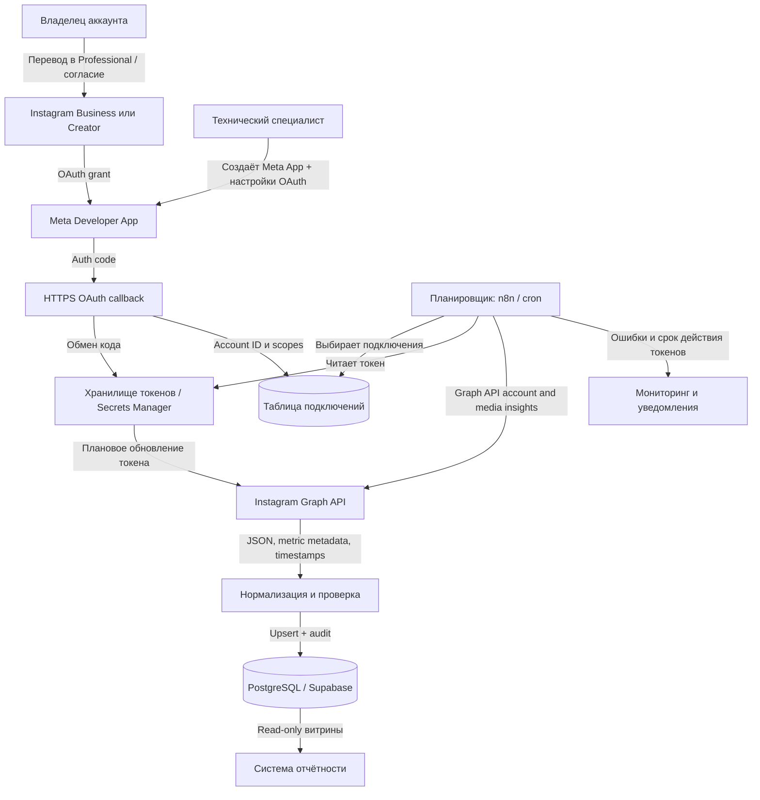

# LD LATTE — проект подключения Instagram-аналитики

**Задача 2: аналитическая записка, без подключения реальных аккаунтов.**
Версия: 5 ноября 2026. План ориентирован на официальную Instagram Platform (Meta Graph API).
В тестовом не нужны реальные пользовательские токены, доступы к аккаунтам или развернутая интеграция.

## 1. Целевая архитектура



## 2. Выбор способа подключения

**Рекомендуемый для нового проекта:** Instagram API with Instagram Login.

- Поддерживаются только профессиональные Instagram-аккаунты (Business или Creator). Личные аккаунты сначала переводятся в Professional.
- Для варианта **Instagram Login** не требуется обязательно связывать Instagram с Facebook Page.
- Нужны `instagram_business_basic` и `instagram_business_manage_insights`.
- Запросы к `graph.instagram.com`; OAuth-авторизация и токены — по документации Meta для Instagram Login.
- **Альтернатива:** Instagram API with Facebook Login. Требуется Facebook Page, связанная с профессиональным Instagram-аккаунтом, и права `instagram_basic`, `instagram_manage_insights`, `pages_read_engagement` (для получения списка Pages могут понадобиться `pages_show_list` и дополнительные права при Business Manager). Запросы идут к `graph.facebook.com`.
- Для собственных аккаунтов, добавленных в роли приложения, может хватить Standard Access; для аккаунтов сторонних клиентов нужен Advanced Access / App Review. Проверить, кто юридически управляет всеми аккаунтами, прежде чем выбирать уровень доступа.
- Разрешения запрашивать по минимально достаточному принципу. Публикация постов, комментарии и сообщения в этом проекте не нужны.

Источник: Meta Instagram Platform docs и официальная коллекция API:
https://developers.facebook.com/docs/instagram-platform/
https://developers.facebook.com/docs/instagram-platform/instagram-api-with-facebook-login/insights
https://www.postman.com/meta/instagram/documentation/6yqw8pt/instagram-api

## 3. Пошаговое подключение — роли и ответственность

| № | Владелец Instagram / компания | Технический специалист | Автоматическая система |
|---|---|---|---|
| 1 | Даёт перечень аккаунтов, подтверждает владение и назначает ответственных | Инвентаризирует аккаунты и метрики | — |
| 2 | Проверяет Business/Creator; при необходимости переводит в Professional | Выбирает Instagram Login или Facebook Login, фиксирует зависимости | — |
| 3 | Подтверждает права на аккаунты и страницы при Facebook Login | Создаёт Meta Developer App, настраивает продукт Instagram, redirect URI, HTTPS, app mode | — |
| 4 | Проходит OAuth и разрешает запрошенные scopes | Настраивает OAuth callback, `state` (CSRF), обмен code на токен | Проверяет `state`, сохраняет срок жизни/ID/scopes |
| 5 | Проверяет, что именно нужный аккаунт подключился | Достаёт IG account ID и профиль, валидирует permissions | Шифрует токен в Secrets Manager |
| 6 | Подтверждает доступность Insights в самом Instagram | Делает пробный запрос account insights и список media | Сохраняет сырые ответы/метаданные для диагностики |
| 7 | Утверждает частоту сбора и список показателей | Строит нормализацию, расписание, retry, UPSERT, мониторинг | Ежедневно опрашивает API и обновляет витрины |
| 8 | Сообщает об изменении пароля, доступов, владельца | Настраивает процедуру повторной авторизации | Обновляет разрешённые токены; сигнализирует об ошибках |

**Поток токена:** redirect с authorization code → безопасный серверный callback → обмен на access token; для Instagram Login при поддержке текущего API — long-lived access token + плановое обновление до истечения срока. Никогда не хранить пользовательский токен в клиентском JavaScript, публичной таблице или Git-репозитории. Refresh/Exchange и срок действия сверять по фактически используемому типу токена и версии API, а не по общему шаблону.

**Первый запрос (схематично, конкретные `metric`/`period` сверять с актуальными allowed values):**

```http
GET https://graph.instagram.com/{API_VERSION}/{IG_USER_ID}/insights?metric=views,reach&period=day
Authorization: Bearer {ACCESS_TOKEN}
```

Получение метрик публикации — отдельным эндпоинтом `/{IG_MEDIA_ID}/insights`. Не смешивать account-level и media-level показатели.

## 4. Таблица метрик и ограничений

| Показатель | Откуда | Условия / период | Ограничения и нюансы |
|---|---|---|---|
| Количество подписчиков сейчас | Поле профессионального профиля `followers_count` | Снимок на момент запроса | Не путать с метрикой изменения числа подписчиков; вести ежедневные snapshots |
| Изменение числа подписчиков | `/IG_USER_ID/insights`, поддерживаемые follower metrics | Зависит от типа аккаунта и версии Graph API | Для некоторых follower-insights действуют пороги (например, от 100 подписчиков). Отсутствующие данные = NULL, не 0 |
| Просмотры аккаунта | `/IG_USER_ID/insights`, `views` | Поддерживаемые периоды и разрезы проверяются в API | С 2025 г. `views` заменили ряд прежних `impressions/plays`; не суммировать несопоставимые метрики |
| Охват аккаунта | `/IG_USER_ID/insights`, `reach`, если доступен | По периодам и account type, проверить при пробном запросе | Доступность метрик меняется; не гарантировать `reach` для каждого среза |
| Просмотры публикации/Reel | `/IG_MEDIA_ID/insights`, `views` | Тип контента определяет поддерживаемые метрики | Для Stories и Reels возможны особые ограничения и окна доступности |
| Охват публикации | `/IG_MEDIA_ID/insights`, `reach` при поддержке | Зависит от типа media и версии API | Может отсутствовать у части объектов или в некоторых API версиях |
| Реакции на публикацию | `/IG_MEDIA_ID/insights`, `likes`, `comments`, `saved`, `shares` | По каждому media ID | `saved/shares` могут отличаться доступностью по типу публикации |
| Сводная вовлечённость | `total_interactions`, где поддерживается | Уровень профиля или media по документации | Проверять метод расчёта, не приравнивать к сумме собственных счётчиков без проверки |

Не делать жёстких допущений о ретроспективных лимитах: Meta периодически меняет сроки, квоты, доступность и имена метрик. Зафиксировать API version при первом успешном запросе и держать совместимость. Многодневные окна `since/until` запрашивать только там, где они поддерживаются данным endpoint/metric. При отсутствии показателя сохранять статус «нет данных», а не 0.

Подтверждения изменений:
https://developers.facebook.com/docs/graph-api/changelog/version22.0/
https://developers.facebook.com/docs/instagram-platform/instagram-api-with-facebook-login/insights

## 5. Несколько аккаунтов и регулярный сбор

**Модель хранения:**

- `instagram_connections`: `id`, `ig_account_id`, `username`, `auth_method`, `secret_ref`, `scopes`, `status`, `token_expires_at`, `last_success_at`.
- `instagram_media`: `ig_media_id`, `ig_account_id`, `media_type`, `published_at`, `permalink`.
- `instagram_insights`: `ig_account_id`, `media_id nullable`, `metric`, `period`, `window_start`, `window_end`, `value_json`, `collected_at`, `api_version`. Уникальный ключ по аккаунту, контенту, метрике и окну.
- `integration_runs`: `account_id`, `started_at`, `ended_at`, `success`, `http_code`, `error_category`, `request_id`. Не логировать токены.

**Расписание:** ежедневно (например, 06:00 UTC) собирать account insights и актуальные media insights с небольшим пересечением окон для поздних обновлений; опционально более частый мониторинг последних публикаций. Расписание, rate limit, backoff (429/5xx), пагинация курсорами, ограниченная конкурентность, инкрементальная синхронизация и атомарный UPSERT. UTC хранить в БД; конвертировать в нужную таймзону только в отчёте. Токены проверять ежедневно и заранее инициировать refresh / повторный OAuth.

**Безопасность:** не передавать все аккаунты одним секретом без разграничения; защищать credentials серверным vault, аудит доступа, немедленная ревокация при увольнении владельца, правило наименьших привилегий.

## 6. Диагностика

| Симптом | Проверка | Действие |
|---|---|---|
| OAuth не завершился | Redirect URI, HTTPS, `state`, app mode, тестовые роли | Исправить настройки и повторить согласие |
| 401/190 token error | Token expires, token revoked, owner changed password | Обновить токен или запросить повторный OAuth |
| 403 permissions | Granted scopes, account type, App Review, page link для FB Login | Выдать нужные права через владельца |
| Пустые insights | Доступность метрики для media/account, минимальный размер аудитории, период и задержки | Перезапросить допустимую метрику/период |
| 400 invalid metric | API version, media type, неподдерживаемые сочетания `period` | Свериться с актуальным справочником Meta |
| 429 / rate limit | Заголовки квот, количество запросов, циклы пагинации | Ограничить rate, exponential backoff с jitter |
| Дубли в отчёте | Уникальные ключи window / media / metric | UPSERT по стабильному ключу |
| Неполная статистика | Пагинация cursor, пропуск страниц, неучтённые Stories | Доработать обход и журнализацию |

## 7. Проверка каждого этапа

1. Каждое подключение видно по ожидаемому `ig_account_id` и username; чужой аккаунт не отображается.
2. В сохранённых scopes есть базовый доступ и нужный insights scope.
3. Пробные GET профиля, списка media, account insights и media insights дают ожидаемые ID и структуру; логировать `trace_id`, а не токен.
4. На тестовом наборе 2–3 аккаунтов данные складываются в разные наборы строк, без перекрёстной примеси.
5. Повторный запуск той же синхронизации не создаёт дубликатов.
6. Смоделировать истёкший токен, 403, 429, 500, пустые metrics и проверить уведомления/повторы.
7. Сравнить последние 1–2 периода с нативной статистикой Instagram (учесть TZ, задержку и различие метрик).
8. Зафиксировать дату и версию Meta API и сохранённый результат пробного запроса.

## 8. Вопросы LD LATTE перед реальной интеграцией

1. Сколько аккаунтов, их типы Business/Creator, единый ли Meta Business Portfolio?
2. Кто юридический владелец и кто может завершить OAuth для каждого аккаунта?
3. Уже существует Meta App? Есть ли Business Verification и App Review? Требуется ли работа с аккаунтами сторонних партнёров?
4. Нужен ли доступ к исторической статистике и на какую глубину? Какие KPI действительно важны?
5. Нужны ли Stories/Reels/платное продвижение отдельно от обычных публикаций?
6. Как часто нужны данные, какой допустимый лаг, какие таймзоны и формат отчётов?
7. Куда сохранять: Supabase/PostgreSQL, BI, Google Sheets или DWH? Какая политика хранения и права доступа?
8. Кто поддерживает токены и исправляет сбои? Кто получает алерты?
9. Какова политика безопасности, где хранить секреты, кому запрещён доступ к аккаунтам?
10. Как проверять совпадение данных и принимать работы?

## 9. Источники для сверки

- Meta Instagram Platform: https://developers.facebook.com/docs/instagram-platform/
- Meta Instagram Insights: https://developers.facebook.com/docs/instagram-platform/instagram-api-with-facebook-login/insights
- Meta Business Login: https://developers.facebook.com/docs/instagram-platform/instagram-api-with-instagram-login/business-login
- Meta Graph API changelog v22: https://developers.facebook.com/docs/graph-api/changelog/version22.0/
- Meta official Postman collection: https://www.postman.com/meta/instagram/documentation/6yqw8pt/instagram-api

**Область задания:** только проект интеграции; никаких реальных аккаунтов компании или токенов не запрашивалось.
